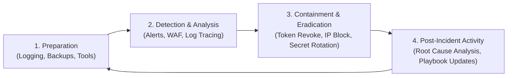

# ZEN GLOBAL – SECURITY INCIDENT RESPONSE PLAN (IRP)

**Document ID:** SEC-IRP-2026-11  
**Standard:** NIST SP 800-61 Rev. 2 (Computer Security Incident Handling Guide)  
**Effective Date:** November 2026  
**Classification:** Confidential / Operational Security Policy  

---

## 1. Incident Response Lifecycle & Phases

The Zen Incident Response Plan follows the standard NIST four-phase lifecycle:

---

## 2. Severity Classification Matrix

| Severity Level | Response SLA | Criteria | Incident Commander |
| :--- | :---: | :--- | :--- |
| **SEV-1 (Critical)** | **< 15 minutes** | Active database breach, unauthorized administrative access, payment bypass or mass fraudulent captures, infrastructure takeover. | Principal Security Architect & CTO |
| **SEV-2 (High)** | **< 1 hour** | High-volume brute force credential stuffing, failure of webhook signature verification, malicious file upload attempt, severe SSRF attempt. | Senior DevSecOps Engineer |
| **SEV-3 (Medium)** | **< 4 hours** | Sustained rate limit violations, isolated account compromise report, localized application error spikes. | Full-Stack Lead Engineer |
| **SEV-4 (Low)** | **< 24 hours** | Minor scanner probes, benign input validation rejections, single failed login attempts. | Security Operations Analyst |

---

## 3. Incident Response Playbooks

### Playbook A: Credential / Secret Leakage
1. **Identification:** Detect exposed secret (JWT `SECRET_KEY`, PayPal API Secret, or database credentials).
2. **Immediate Containment:**
   - Invalidate the compromised credential immediately in the external provider dashboard (e.g. PayPal Developer Portal).
   - Invalidate all active user JWT tokens by rotating `SECRET_KEY` in `Zen/backend/.env`.
   - Restart the backend container (`docker-compose restart backend`).
3. **Eradication:**
   - Verify Git commit history using Gitleaks/TruffleHog to ensure the secret was not committed to source repositories.
   - If committed, scrub repository history and rotate all related credentials across all environments.
4. **Recovery & Verification:**
   - Validate system health via `GET /health/ready`.
   - Monitor login rates and authentication failure counters.

### Playbook B: Payment Discrepancy or Webhook Forgery
1. **Identification:** Discrepancy detected between PayPal transaction records and internal `orders` table, or unverified webhook events recorded.
2. **Immediate Containment:**
   - Temporarily pause automatic fulfillment state updates for unconfirmed orders.
   - Inspect `webhook_events` table for duplicate event IDs or suspicious origins.
3. **Eradication:**
   - Verify all incoming requests to `/api/payments/webhook` against PayPal's verification endpoint.
   - Reconcile affected orders directly with the official PayPal Merchant Portal.
4. **Recovery:**
   - Issue automated refunds for any duplicate captures using `POST /api/payments/refund`.
   - Update in-app notifications to notify affected buyers.

### Playbook C: Malicious File Upload Attempt
1. **Identification:** Alert triggered by `uploads.py` for MIME spoofing or prohibited SVG / executable headers.
2. **Immediate Containment:**
   - Isolate the requesting IP address at the reverse proxy / firewall level.
   - Quarantine any files uploaded within the same IP session window in `static/uploads/`.
3. **Eradication:**
   - Inspect quarantined files using static malware analysis tools.
   - Delete quarantined files from disk.
4. **Recovery:**
   - Confirm upload directory permissions remain read/write without execution flags (`noexec`).

### Playbook D: Distributed Denial of Service (DDoS)
1. **Identification:** Sudden spike in HTTP 429 rate limit errors or elevated response times (`X-Response-Time-Ms > 2000ms`).
2. **Immediate Containment:**
   - Enable "Under Attack Mode" on Cloudflare / CDN edge.
   - Tighten sliding window thresholds in `InMemoryRateLimiter`.
   - Block malicious subnet ranges at the Nginx reverse proxy level.
3. **Recovery:**
   - Monitor container resource metrics (`docker stats`).
   - Gradually restore standard rate limit thresholds as anomalous traffic subsides.

---

## 4. Emergency Contacts & Escalation Roster

- **Primary Incident Commander:** Security Lead (`security@zen.global`)
- **Infrastructure Operations:** DevSecOps Lead (`ops@zen.global`)
- **PayPal Partner Support:** PayPal Developer Escalation Portal
- **Hosting / Cloud Provider:** Support Hotline & Emergency Console

