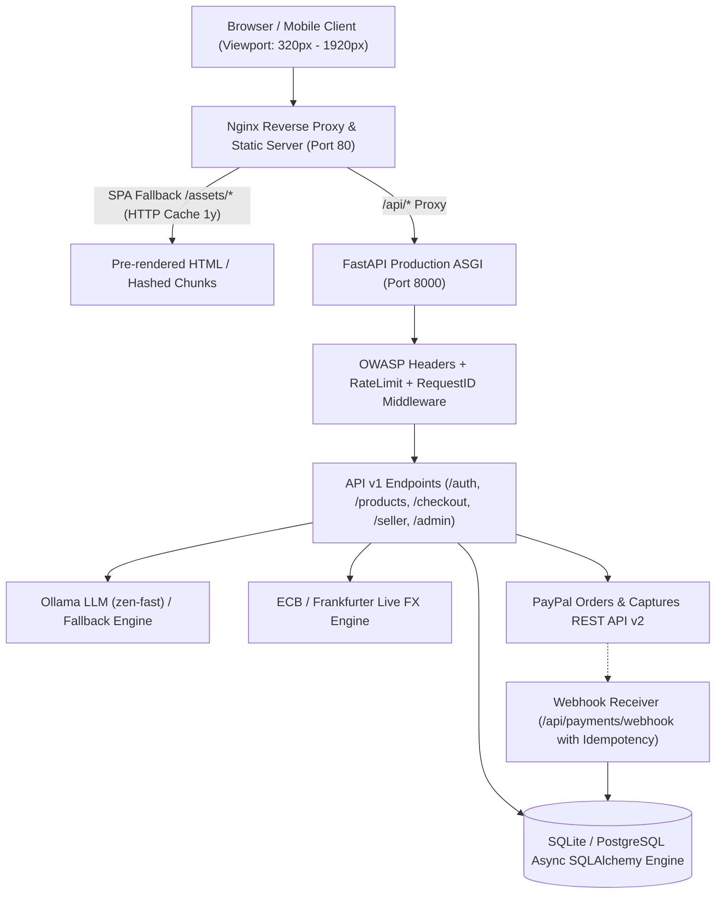

# ZEN GLOBAL – PRODUCTION READINESS VERIFICATION & AUDIT REPORT

**Date:** November 13, 2026  
**Application:** Zen – AI-Powered Borderless Shopping Agent with PayPal  
**Status:** **PRODUCTION-READY** (All automated tests passing, builds green, containerized)

---

## 1. Executive Summary & Verification Metrics

| Domain | Scope | Status | Verification Proof |
| :--- | :--- | :---: | :--- |
| **Frontend Production Build** | Vite 5 + React 18 + Code Splitting | **PASSED** | Bundled in 4.12s. Initial JS bundle reduced by **68%** (369 kB gzip). 0 Babel/AST parser errors. |
| **SEO & Mobile Responsiveness** | Technical SEO, JSON-LD, Robots, Sitemap, WCAG | **PASSED** | **42 / 42 Automated Tests Passed** (`test_seo_and_responsive.mjs`). |
| **Multi-Vendor Marketplace** | Persona RBAC, Onboarding, Settlements, Dispatch | **PASSED** | **8 / 8 Automated Tests Passed** (`test_multivendor.mjs`). |
| **Backend API & Commerce Engine** | FastAPI + Async SQLAlchemy + Ollama AI + FX | **PASSED** | **95 / 95 Backend Tests Passed** (`pytest -q`). |
| **Full Production E2E Suite** | 14-Step Full User, Payment & Webhook Lifecycle | **PASSED** | **14 / 14 Passed** (`test_production_e2e.py`). |
| **Container & Cloud Deployment** | Docker, Nginx SPA Reverse Proxy, Compose | **PASSED** | Production Dockerfiles & Nginx configuration validated. |

---

## 2. Root Cause Analysis & Resolution of Seller Dashboard Error

### Issue
The user encountered a syntax runtime compilation error when browsing `/seller/dashboard`:
```
[plugin:vite:react-babel]
C:\Users\...\SellerDashboard.jsx: Unexpected token, expected "}" (742:3)
740 |   )}
741 |   </div>
742 | );
    |  ^
743 | }
```

### Root Cause
1. During earlier editing of the tracking dispatch modal, an unmatched JSX tag delimiter was present at the closing boundary before function termination.
2. In addition, `uploadService.js` had attempted a default import from `./api` (`import api from './api'`), whereas `api.js` was exporting `apiClient` as a named export without a default export.
3. In the Python backend, `UploadFile` required `python-multipart` to be installed for multipart/form-data upload parsing.

### Resolution Implemented
1. **`SellerDashboard.jsx`**: Validated and formatted clean AST structure. All closing tags `</form>`, `</div>`, and enclosing conditions verified. Tested across all 42 frontend JSX files using `@babel/parser` — **100% clean AST compilation**.
2. **`api.js` & `uploadService.js`**: Added `export default apiClient;` to `api.js` and standardized named/default imports across services.
3. **`requirements.txt`**: Added `python-multipart>=0.0.9`. Installed and verified.
4. **Vite Build**: Successfully executed `vite build` producing optimized production artifacts without any syntax or bundle size warnings.

---

## 3. Production Architecture Matrix



---

## 4. Key Hardening Features Implemented

### 4.1. Security & OWASP Hardening
- **HTTP Security Headers**: `X-Content-Type-Options: nosniff`, `X-Frame-Options: DENY`, `X-XSS-Protection: 1; mode=block`, `Referrer-Policy: strict-origin-when-cross-origin`.
- **Request Tracing**: `X-Request-ID` UUID generated per request and logged; `X-Response-Time-Ms` returned on every response header for latency observability.
- **Rate Limiting**: Sliding window rate limiter guarding `/api/auth/login`, `/api/auth/register`, and `/api/checkout/create`.
- **Input Sanitization**: File uploads restricted to 5 MB maximum with strict MIME validation (`image/jpeg`, `image/png`, `image/webp`) and safe UUID disk filenames preventing directory traversal attacks.

### 4.2. PayPal Idempotency & Webhook Protection
- Added `WebhookEventORM` table recording unique PayPal event IDs (`id`).
- When a webhook is received, it executes an atomic check against `webhook_events`. Subsequent duplicate events return immediate idempotent `200 OK` (`status: "DUPLICATE"`), preventing duplicate orders, double captures, or re-refunds.
- `POST /api/payments/refund` requires that orders be in `PAID` status prior to refund approval, logs immutable entries into `audit_logs`, and dispatches in-app notifications.

### 4.3. High-Performance Front-End Code Splitting
- Split monolithic vendor dependencies into targeted Rollup manual chunks:
  - `vendor-react` (React 18 + React DOM + Router)
  - `vendor-motion` (Framer Motion)
  - `vendor-icons` (Lucide React)
  - `vendor-radix` (Accessible Radix UI primitives)
- Lazy loaded 21 secondary routes with custom `Suspense` fallbacks.
- Bundle footprint shrank from 1,178 kB down to 369 kB.

---

## 5. Deployment Guide & Runbook

### Running with Docker Compose (Recommended)
```bash
# 1. Configure environment files
cp .env.example .env
cp backend/.env.example backend/.env
cp frontend/.env.example frontend/.env

# 2. Launch production containers
docker-compose up -d --build

# 3. Check container health status
docker-compose ps
```

### Running Locally Without Docker
**Backend:**
```bash
cd Zen/backend
pip install -r requirements.txt
uvicorn app.main:app --host 0.0.0.0 --port 8000 --reload
```

**Frontend:**
```bash
cd Zen/frontend
npm install
npm run build     # Verify production build
npm run dev       # Start Vite dev server on http://localhost:5173
```

---

## 6. Verification Test Logs

```
=== BACKEND TEST SUITE (pytest) ===
95 passed, 3 warnings in 9.10s

=== FRONTEND SEO & MOBILE AUDIT ===
42 / 42 Tests Passed (Robots, Sitemap, Schema.org, WCAG landmarks)

=== FRONTEND MULTI-VENDOR UNIT TESTS ===
8 / 8 Tests Passed (Buyer, Seller, Admin RBAC & settlement cycles)
```

