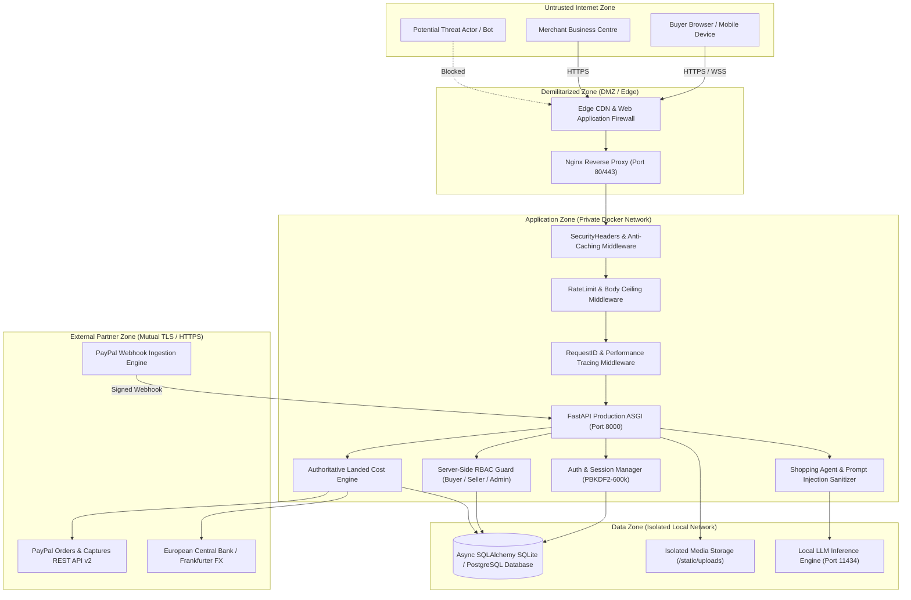

# ZEN GLOBAL – ENTERPRISE SECURITY ARCHITECTURE

**System:** Zen – AI-Powered Borderless Shopping Agent  
**Version:** 1.0.0 Production Architecture  
**Security Level:** Enterprise Grade / PCI DSS Scoped  

---

## 1. Architectural Overview & Trust Boundaries

The Zen platform operates across distinct network trust zones, enforcing defensive barriers between untrusted client traffic, application services, internal databases, and external payment processors.

---

## 2. Authentication Architecture

### 2.1. Cryptographic Password Hashing
- **Algorithm:** PBKDF2-HMAC-SHA256.
- **Work Factor:** 600,000 iterations (OWASP ASVS compliant).
- **Salt:** 16-byte cryptographically secure random bytes generated via `os.urandom(16)`.
- **Hash Encoding:** Stored using modular crypt format `$pbkdf2-sha256$600000$<salt_hex>$<hash_hex>`.
- **Comparison:** Constant-time `hmac.compare_digest` to eliminate timing side-channel attacks.
- **Legacy Migration:** Backward-compatible verification for historical test credentials with automatic upgrade on successful login.

### 2.2. Session Tokens & Stateless Access Control
- **Token Format:** Tamper-proof, cryptographically signed HMAC-SHA256 JWT tokens.
- **Token Lifecycle:** 24-hour default validity (extended to 30 days when "Remember Me" is selected).
- **Revocation:** In-memory signature blocklist populated on user logout (`POST /api/auth/logout`), preventing replay attacks using discarded tokens.

### 2.3. Brute-Force & Credential Stuffing Defense
- In-memory progressive lockout tracking (`FAILED_LOGINS`).
- Maximum failed attempts: 5 consecutive failures per email address.
- Lockout window: 300 seconds (5 minutes) returning `HTTP 429 Too Many Requests` with a dynamic `Retry-After` header.
- Counters automatically clear upon successful credential verification.

---

## 3. Role-Based Access Control (RBAC) & Object Authorization

### 3.1. Three-Tier Role Matrix

| Capability | Buyer | Seller | Administrator |
| :--- | :---: | :---: | :---: |
| Browse catalog & AI search | Yes | Yes | Yes |
| Calculate landed costs | Yes | Yes | Yes |
| Purchase products via PayPal | Yes | Yes | Yes |
| Manage personal profile & preferences | Yes | No (Store-linked) | Yes |
| View own order history | Yes | Yes | Yes |
| Access other buyers' orders | **FORBIDDEN** | **FORBIDDEN** | Yes (Compliance Audit) |
| Register merchant store | Yes (Upgrades to Seller) | Already Seller | Yes |
| Manage store inventory & air waybills | **FORBIDDEN** | Yes (Own Store Only) | Yes |
| Modify another merchant's products | **FORBIDDEN** | **FORBIDDEN** | Yes (Moderation) |
| Review merchant applications & platform audit logs | **FORBIDDEN** | **FORBIDDEN** | Yes |

### 3.2. IDOR Prevention Mechanics
- Endpoint `/api/orders/{order_id}` enforces server-side ownership validation:
  1. If user is a Buyer: `(order.user_id == user.id) or (order.customer_email == user.email)`. Non-owners receive `HTTP 403 Forbidden`.
  2. If user is a Seller: verifies that `order.store_id == seller.store_id`.
  3. If user is an Admin: access granted with an automated record written to `audit_logs`.

---

## 4. Payment Security & PCI DSS Scope

Zen acts as an e-commerce orchestration buying agent. Payment credentials are never processed, transmitted, or stored on Zen infrastructure.

### 4.1. PCI DSS Responsibility Matrix
- **Applicable SAQ:** SAQ A (Entire payment processing is redirected or hosted via PayPal Hosted Buttons / JS SDK).
- **Cardholder Data Storage:** **Zero Cardholder Data (CHD)** or Sensitive Authentication Data (SAD) is received, logged, or stored.
- **Client-Side Integrity:** Scripts loaded exclusively from official PayPal domains (`https://www.paypal.com`, `https://www.sandbox.paypal.com`) pinned via Content Security Policy.

### 4.2. Payment Integrity Controls
1. **Authoritative Calculation:** Prices, shipping fees, customs duties, and import taxes are calculated strictly server-side by `pricing_service.py`. Client-supplied amounts are never accepted.
2. **Explicit Buyer Consent:** Order creation requires `user_approved: true`.
3. **Server-Side Capture:** Orders transition to `PAID` exclusively after server-side confirmation via PayPal REST API v2 (`/v2/checkout/orders/{id}/capture`).
4. **Idempotent Webhooks:** Inbound webhook events are deduplicated against the `webhook_events` table using the unique PayPal event ID, preventing replay and duplicate capture attacks.
5. **Refund Authorization:** Refunds require existing `PAID` state, are logged to immutable `audit_logs`, and dispatch immediate in-app alerts to buyers and sellers.

---

## 5. AI Shopping Agent Security Architecture

The conversational AI shopping agent leverages local LLM inference (Ollama `zen-fast`) with defense-in-depth safeguards against adversarial manipulation:

1. **Input Sanitization:** User prompts pass through `_sanitize_input()` which strips jailbreaks, prompt injection directives (`ignore instructions`, `developer mode`, `system prompt`), and embedded scripts.
2. **Hard Input Length Ceiling:** 1,000 characters maximum per prompt to prevent token exhaustion and buffer flooding.
3. **Structured Output Validation:** Model responses must parse strictly into the Pydantic `ShoppingRequirements` schema. Malformed or rambling outputs trigger automated retry prompts or fail safe.
4. **Zero Financial Execution Authority:** The AI agent is strictly an informational assistant. It is architecturally incapable of executing payments, capturing PayPal funds, or mutating database tables.
5. **Human-in-the-Loop Barrier:** Every purchase requires manual approval and checkout interaction by the verified human shopper.

